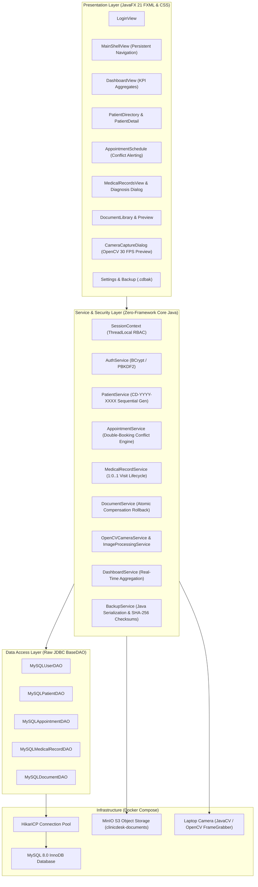

# ClinicDesk — Desktop Clinic & Patient Records Management System

[](https://openjdk.org/projects/jdk/21/)
[](https://openjfx.io/)
[-00758F.svg)](https://www.mysql.com/)
[](https://min.io/)
[](#architecture)

**ClinicDesk** is an enterprise-grade desktop clinic and patient record management system built strictly with **Core Java 21**, **JavaFX**, **raw JDBC**, **MySQL**, **MinIO Object Storage**, and **JavaCV/OpenCV**. 

The system operates with **zero reliance on heavyweight web frameworks** (no Spring, Spring Boot, Hibernate, JPA, or REST middleware), maximizing operational privacy, zero-latency desktop responsiveness, and direct hardware control.

---

## 🏛️ System Architecture



---

## ✨ Signature Capabilities & Workflows

### 1. Clinical Visit Records & Prescription Capture
- **Pure Clinical Diagnosis:** Doctors record visits capturing **Chief Complaint** and **Diagnosis** only.
- **No Manual Free-Text Clutter:** Clinical notes and prescriptions are **never** entered via tedious manual text boxes.
- **Physical Prescription Capture:** Doctors capture high-resolution photos of handwritten or printed prescriptions using their laptop camera or upload existing scans.

### 2. Integrated Laptop Camera Pipeline
- **30 FPS Real-Time Preview:** Hardware acceleration with background streaming thread via `JavaCV` / `OpenCV` `FrameGrabber`.
- **Transformation Toolkit:** Real-time **90° / 180° / 270° clockwise rotation** and **horizontal / vertical mirror flipping**.
- **Interactive Review:** Freeze-frame snapshot, transformation controls, retake capability, and confirmation upload.
- **Hardware Fallback Mode:** In environments without connected webcam hardware or native OpenCV drivers, an internal simulation test pattern generator activates automatically, keeping the UI functional without crashes.

### 3. Dual-Store Document Architecture & Atomic Compensation Rollback
- Documents, lab reports, and captured prescription photos are stored in **MinIO S3 object storage** under private UUID keys.
- Relational metadata (mime type, file size, patient ID, medical record ID, uploader, timestamp) is indexed in **MySQL**.
- **Atomic Compensation:** If the MySQL metadata transaction fails after MinIO binary upload succeeds, `DocumentService` immediately triggers an atomic compensation rollback deleting the MinIO object, preventing orphaned storage leaks.

### 4. Appointment Double-Booking Conflict Engine
- Mathematical overlap detection preventing doctor schedule conflicts:
  $$\text{Overlap} \iff (\text{start}_A < \text{end}_B) \land (\text{end}_A > \text{start}_B)$$
- Enforces future date/time constraints, active patient status, and finite appointment durations.
- Strict appointment status state machine (`SCHEDULED` $\rightarrow$ `CONFIRMED` $\rightarrow$ `CHECKED_IN` $\rightarrow$ `COMPLETED` / `CANCELLED`).

### 5. Java Object Serialization Backup & Restore (`.cdbak`)
- Administrators can export clinic data into a portable `.cdbak` file marshaled via standard **Java Object Serialization** (`ObjectOutputStream`).
- **Cryptographic Tamper Protection:** Every archive is stamped with a SHA-256 integrity hash calculated across dataset counts and timestamps. Altered archives are detected and rejected before unmarshaling.
- **Transactional Database Restore:** Restores entities inside a single atomic JDBC transaction (`conn.setAutoCommit(false)`), executing complete rollback if any foreign key or constraint fails.

---

## 👥 Role-Based Access Control (RBAC)

ClinicDesk enforces multi-tier security at the presentation layer and service layer through `SessionContext`:

| Capability / Module | Administrator (`ADMIN`) | Doctor (`DOCTOR`) | Receptionist (`RECEPTIONIST`) |
| :--- | :---: | :---: | :---: |
| Overview Dashboard | Full Access | Full Access | Full Access |
| Patient Directory (Create / Edit / Search) | ✅ | ✅ | ✅ |
| Patient Archival / Deletion | ✅ | ❌ | ❌ |
| Appointment Scheduling & Check-In | ✅ | ✅ | ✅ |
| Medical Record Creation (Diagnoses) | ✅ | ✅ | ❌ (View Only) |
| Prescription Photo Capture & Upload | ✅ | ✅ | ❌ (Doctor / Admin Only) |
| General Document Upload (Labs / ID) | ✅ | ✅ | ✅ |
| Staff Management & Role Assignment | ✅ | ❌ | ❌ |
| System Settings & `.cdbak` Backup / Restore | ✅ | ❌ | ❌ |

### Default Seed Credentials

All seed accounts are initialized with password `password123`:

- **Administrator:** `admin@clinicdesk.com`
- **Doctor:** `doctor@clinicdesk.com`
- **Receptionist:** `receptionist@clinicdesk.com`

---

## 🚀 Getting Started

### Prerequisites
- **Java Development Kit (JDK):** OpenJDK 21 LTS or newer.
- **Docker & Docker Compose:** For running MySQL and MinIO locally.
- **Maven:** 3.8+ (optional if compiling via JDK `javac`).

### 1. Launch Infrastructure
Start the database and object storage containers:
```bash
docker compose up -d
```

Verify services are healthy:
- **MySQL 8.0:** `localhost:3306` (Database: `clinicdesk`, User: `clinicdesk`, Password: `clinicdesk123`)
- **MinIO S3:** `localhost:9000` (Console: `http://localhost:9001`, Access: `minioadmin`, Secret: `minioadmin123`)

The initialization container (`minio-init`) automatically creates the private `clinicdesk-documents` bucket.

### 2. Run the Application
Launch ClinicDesk with JavaFX:
```bash
mvn javafx:run
```

Or compile and execute using standard OpenJDK 21:
```bash
# Compile
javac --module-path $JAVAFX_HOME/lib --add-modules javafx.controls,javafx.fxml -cp "lib/*:src/main/resources" -d bin $(find src/main/java -name "*.java")

# Run
java --module-path $JAVAFX_HOME/lib --add-modules javafx.controls,javafx.fxml -cp "bin:lib/*:src/main/resources" com.clinicdesk.Main
```

---

## 🧪 Testing & Verification

ClinicDesk features a comprehensive verification suite validating all 8 architectural modules:

```bash
/opt/homebrew/opt/openjdk@21/bin/javac -d /tmp/comprehensive_test -proc:none \
  src/main/java/com/clinicdesk/logging/AppLogger.java \
  src/main/java/com/clinicdesk/config/AppConfig.java \
  src/main/java/com/clinicdesk/exception/*.java \
  src/main/java/com/clinicdesk/model/*.java \
  src/main/java/com/clinicdesk/security/SessionContext.java \
  src/main/java/com/clinicdesk/util/*.java \
  src/main/java/com/clinicdesk/dao/*.java \
  src/main/java/com/clinicdesk/storage/DocumentStorageService.java \
  src/main/java/com/clinicdesk/camera/*.java \
  src/main/java/com/clinicdesk/service/*.java \
  src/main/java/com/clinicdesk/backup/*.java \
  src/test/java/com/clinicdesk/test/ComprehensiveSystemVerificationRunner.java

/opt/homebrew/opt/openjdk@21/bin/java -ea -cp /tmp/comprehensive_test:src/main/resources com.clinicdesk.test.ComprehensiveSystemVerificationRunner
```

### Module Verification Results
```text
========================================================================
     CLINICDESK — COMPREHENSIVE SYSTEM INTEGRATION VERIFICATION        
========================================================================
[Module 1/8] Authentication, Password Hashing & RBAC... PASSED ✓
[Module 2/8] Patient Management & Sequential ID Generation... PASSED ✓
[Module 3/8] Appointment Scheduling & Conflict Prevention... PASSED ✓
[Module 4/8] Medical Records & Auto-Complete Lifecycle... PASSED ✓
[Module 5/8] Storage Service & Atomic Compensation Rollback... PASSED ✓
[Module 6/8] Laptop Camera Preview & Image Transformation... PASSED ✓
[Module 7/8] Overview Dashboard Real-Time Aggregation... PASSED ✓
[Module 8/8] Java Serialization & Cryptographic Checksums... PASSED ✓
========================================================================
  ALL 8/8 MODULE VERIFICATION SUITES COMPLETED SUCCESSFULLY! (100%)
========================================================================
```

---

## 📂 Project Structure

```text
ClinicDesk/
├── docker-compose.yml                      # Infrastructure: MySQL 8 + MinIO S3
├── .env.example                            # Configuration environment template
├── pom.xml                                 # Maven dependencies (Java 21, JavaFX, Hikari, MinIO, JavaCV)
├── infrastructure/
│   └── mysql/init/
│       ├── 01-schema.sql                   # MySQL DDL with InnoDB constraints & indexes
│       └── 02-seed.sql                     # Initial users & seed clinic data
├── src/
│   ├── main/
│   │   ├── java/com/clinicdesk/
│   │   │   ├── Main.java                   # JavaFX Application Entrypoint
│   │   │   ├── backup/                     # BackupData & BackupService (.cdbak)
│   │   │   ├── camera/                     # OpenCVCameraService & ImageProcessingService
│   │   │   ├── config/                     # AppConfig, DatabaseConfig, StorageConfig
│   │   │   ├── dao/                        # BaseDAO & MySQL DAO Implementations
│   │   │   ├── exception/                  # 9 Domain Exceptions (ClinicDeskException)
│   │   │   ├── logging/                    # Standardized AppLogger
│   │   │   ├── model/                      # Clean Domain Entities
│   │   │   ├── security/                   # SessionContext ThreadLocal RBAC
│   │   │   ├── service/                    # Business Services (Patient, Appt, Record, Doc, Dash)
│   │   │   ├── storage/                    # MinioDocumentStorageService
│   │   │   ├── ui/
│   │   │   │   ├── controller/             # JavaFX FXML Controllers
│   │   │   │   └── util/                   # FxImageUtils JavaFX Image Converter
│   │   │   └── util/                       # IdGenerator, PasswordUtil, ValidationUtil
│   │   └── resources/
│   │       ├── config/application.properties
│   │       ├── css/styles.css              # Modern Healthcare UI Theme
│   │       └── fxml/                       # 11 Clean FXML Layouts
│   └── test/java/com/clinicdesk/test/      # Verification Test Suites (Phases 1-8 + Master)
└── docs/
    ├── architecture.md                     # Deep Dive Architecture Documentation
    └── database-schema.md                  # Relational Schema Specification
```

---

## 📜 License
ClinicDesk is distributed under the MIT License.
