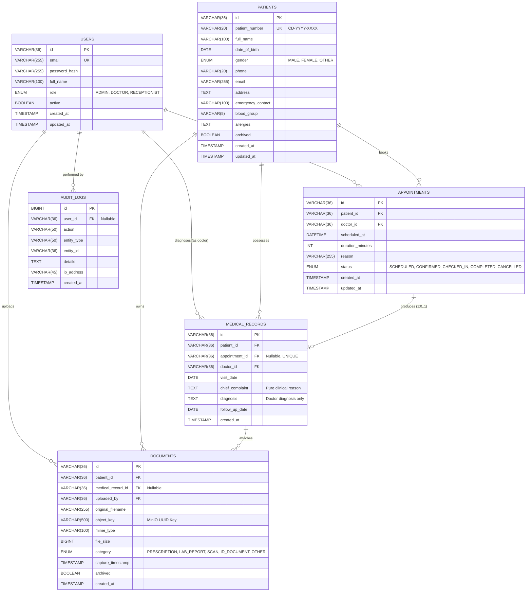

# ClinicDesk — Database Schema & Data Dictionary

This document details the relational data schema for **ClinicDesk**, deployed on **MySQL 8.0+** using the **InnoDB** storage engine with **UTF-8 (utf8mb4)** character encoding.

---

## 1. Entity-Relationship Diagram (ERD)

---

## 2. Table Specifications

### 2.1 `users`
Stores user identities, administrative credentials, and role assignments.

| Column | Type | Constraints | Description |
| :--- | :--- | :--- | :--- |
| `id` | VARCHAR(36) | PRIMARY KEY | UUID v4 unique identifier |
| `email` | VARCHAR(255) | UNIQUE, NOT NULL | Staff login email address |
| `password_hash` | VARCHAR(255) | NOT NULL | BCrypt / PBKDF2 hashed password |
| `full_name` | VARCHAR(100) | NOT NULL | Display name of staff member |
| `role` | ENUM | NOT NULL | `'ADMIN'`, `'DOCTOR'`, `'RECEPTIONIST'` |
| `active` | BOOLEAN | DEFAULT TRUE | Account state (soft deactivation) |
| `created_at` | TIMESTAMP | DEFAULT CURRENT_TIMESTAMP | Record creation timestamp |
| `updated_at` | TIMESTAMP | ON UPDATE CURRENT_TIMESTAMP | Record update timestamp |

---

### 2.2 `patients`
Stores demographic, contact, and clinical baseline information.

| Column | Type | Constraints | Description |
| :--- | :--- | :--- | :--- |
| `id` | VARCHAR(36) | PRIMARY KEY | UUID v4 unique identifier |
| `patient_number` | VARCHAR(20) | UNIQUE, NOT NULL | Sequential ID formatted as `CD-YYYY-XXXX` |
| `full_name` | VARCHAR(100) | NOT NULL | Patient's full legal name |
| `date_of_birth` | DATE | NOT NULL | Date of birth |
| `gender` | ENUM | NOT NULL | `'MALE'`, `'FEMALE'`, `'OTHER'` |
| `phone` | VARCHAR(20) | NOT NULL | Primary contact phone number |
| `email` | VARCHAR(255) | NULL | Optional email address |
| `address` | TEXT | NULL | Residential address |
| `emergency_contact` | VARCHAR(100) | NULL | Name and phone of emergency contact |
| `blood_group` | VARCHAR(5) | NULL | e.g. `'A+'`, `'O-'`, `'AB+'` |
| `allergies` | TEXT | NULL | Comma-delimited list of known drug/food allergies |
| `archived` | BOOLEAN | DEFAULT FALSE | Soft-deletion flag |
| `created_at` | TIMESTAMP | DEFAULT CURRENT_TIMESTAMP | Registration timestamp |
| `updated_at` | TIMESTAMP | ON UPDATE CURRENT_TIMESTAMP | Last update timestamp |

**Indexes:**
- `idx_patient_number (patient_number)`
- `idx_patient_phone (phone)`
- `idx_patient_name (full_name)`

---

### 2.3 `appointments`
Manages consultations and enforces double-booking prevention.

| Column | Type | Constraints | Description |
| :--- | :--- | :--- | :--- |
| `id` | VARCHAR(36) | PRIMARY KEY | UUID v4 unique identifier |
| `patient_id` | VARCHAR(36) | FK $\rightarrow$ `patients(id)` | Patient booking consultation |
| `doctor_id` | VARCHAR(36) | FK $\rightarrow$ `users(id)` | Doctor assigned to consultation |
| `scheduled_at` | DATETIME | NOT NULL | Consultation start date & time |
| `duration_minutes` | INT | DEFAULT 30, NOT NULL | Duration of slot in minutes |
| `reason` | VARCHAR(255) | NOT NULL | Chief complaint or visit reason |
| `status` | ENUM | NOT NULL | `'SCHEDULED'`, `'CONFIRMED'`, `'CHECKED_IN'`, `'COMPLETED'`, `'CANCELLED'` |
| `created_at` | TIMESTAMP | DEFAULT CURRENT_TIMESTAMP | Booking timestamp |
| `updated_at` | TIMESTAMP | ON UPDATE CURRENT_TIMESTAMP | Last status transition timestamp |

**Indexes:**
- `idx_appointment_doctor_time (doctor_id, scheduled_at)` — Accelerates double-booking conflict queries.
- `idx_appointment_patient (patient_id)`
- `idx_appointment_date (scheduled_at)`

---

### 2.4 `medical_records`
Encapsulates visit outcomes. Contains **strictly** Chief Complaint and Diagnosis.

| Column | Type | Constraints | Description |
| :--- | :--- | :--- | :--- |
| `id` | VARCHAR(36) | PRIMARY KEY | UUID v4 unique identifier |
| `patient_id` | VARCHAR(36) | FK $\rightarrow$ `patients(id)` | Patient receiving diagnosis |
| `appointment_id` | VARCHAR(36) | FK $\rightarrow$ `appointments(id)`, UNIQUE | Linked appointment (1:0..1 cardinality) |
| `doctor_id` | VARCHAR(36) | FK $\rightarrow$ `users(id)` | Diagnosing physician |
| `visit_date` | DATE | NOT NULL | Date of consultation visit |
| `chief_complaint` | TEXT | NOT NULL | Patient's reported primary symptoms |
| `diagnosis` | TEXT | NOT NULL | Confirmed medical diagnosis (no text notes) |
| `follow_up_date` | DATE | NULL | Optional recommended follow-up date |
| `created_at` | TIMESTAMP | DEFAULT CURRENT_TIMESTAMP | Record creation timestamp |

**Indexes:**
- `idx_medrecord_patient_date (patient_id, visit_date DESC)` — Accelerates longitudinal history view.
- `idx_medrecord_appointment (appointment_id)`

---

### 2.5 `documents`
Stores metadata for binary objects residing in MinIO S3 object storage.

| Column | Type | Constraints | Description |
| :--- | :--- | :--- | :--- |
| `id` | VARCHAR(36) | PRIMARY KEY | UUID v4 unique identifier |
| `patient_id` | VARCHAR(36) | FK $\rightarrow$ `patients(id)` | Patient document owner |
| `medical_record_id` | VARCHAR(36) | FK $\rightarrow$ `medical_records(id)` | Optional link to clinical encounter |
| `uploaded_by` | VARCHAR(36) | FK $\rightarrow$ `users(id)` | Staff member who uploaded or captured doc |
| `original_filename` | VARCHAR(255) | NOT NULL | Original filename or auto-generated name |
| `object_key` | VARCHAR(500) | NOT NULL | Private MinIO S3 bucket object key |
| `mime_type` | VARCHAR(100) | NOT NULL | `'image/jpeg'`, `'image/png'`, `'application/pdf'` |
| `file_size` | BIGINT | NOT NULL | File size in bytes |
| `category` | ENUM | NOT NULL | `'PRESCRIPTION'`, `'LAB_REPORT'`, `'SCAN'`, `'ID_DOCUMENT'`, `'OTHER'` |
| `capture_timestamp` | TIMESTAMP | NULL | Webcam capture hardware timestamp |
| `archived` | BOOLEAN | DEFAULT FALSE | Soft-deletion flag |
| `created_at` | TIMESTAMP | DEFAULT CURRENT_TIMESTAMP | Metadata creation timestamp |

**Indexes:**
- `idx_doc_patient (patient_id)`
- `idx_doc_medical_record (medical_record_id)`
- `idx_doc_category (category)`
- `idx_doc_object_key (object_key)`

---

### 2.6 `audit_logs`
Chronological append-only compliance journal.

| Column | Type | Constraints | Description |
| :--- | :--- | :--- | :--- |
| `id` | BIGINT | AUTO_INCREMENT, PK | Incremental log sequence ID |
| `user_id` | VARCHAR(36) | FK $\rightarrow$ `users(id)`, SET NULL | Acting staff member |
| `action` | VARCHAR(50) | NOT NULL | e.g. `'LOGIN'`, `'CREATE'`, `'UPDATE'`, `'DELETE'`, `'EXPORT_BACKUP'` |
| `entity_type` | VARCHAR(50) | NOT NULL | e.g. `'PATIENT'`, `'APPOINTMENT'`, `'DOCUMENT'` |
| `entity_id` | VARCHAR(36) | NULL | Primary key of affected entity |
| `details` | TEXT | NULL | JSON or textual description of operation |
| `ip_address` | VARCHAR(45) | NULL | Client IP / hostname |
| `created_at` | TIMESTAMP | DEFAULT CURRENT_TIMESTAMP | Event timestamp |

---

## 3. Data Integrity & Constraints

1. **Sequential Patient Numbering:** Patient numbers follow `CD-YYYY-XXXX`. Sequence generation is computed atomically within `PatientService` using `SELECT COALESCE(MAX(SUBSTRING(patient_number, 9)), 0) FROM patients WHERE patient_number LIKE 'CD-YYYY-%'`.
2. **1:0..1 Visit Cardinality:** `medical_records.appointment_id` is constrained with a `UNIQUE` index. An appointment can produce at most one official clinical encounter record.
3. **Foreign Key Deletion Rules:**
   - Patient deletion uses soft-deletion (`archived = TRUE`) to preserve referential integrity across historical appointments and documents.
   - Deleting an appointment or medical record cascades safely or is restricted via explicit foreign key constraints.
